  &nbsp;
  &nbsp;
  

### Overview

### Skills

### Activity

### Work

### Stack

Cards are generated by a GitHub Action (<code>scripts/build.py</code>) every 12 hours. Brand icons: <a href="https://simpleicons.org">Simple Icons</a> (CC0). Interface icons: <a href="https://primer.style/foundations/icons">GitHub Octicons</a> (MIT). Fonts: Space Grotesk and JetBrains Mono (SIL OFL).
