  &nbsp;
  &nbsp;
  

Recent graduate in **Telecommunications and ICT** from **ENSTTIC**, Oran, Algeria. I build full-stack web applications with **Next.js, the MERN stack and Laravel**, ship them with **Docker and Kubernetes**, and I'm growing into **machine learning**: my final-year project detects cardiovascular disease from ECG images with deep learning.

Currently looking for an **internship or fixed-term position (CDD)** in full-stack development, AI/ML, IP networking or DevOps.

### Overview

### Activity

### Work

### Stack

Brand icons: <a href="https://simpleicons.org">Simple Icons</a> (CC0). Interface icons: <a href="https://primer.style/foundations/icons">GitHub Octicons</a> (MIT). Fonts: Poppins and DejaVu Sans Mono (open licences), embedded in each card. Every card is generated by a GitHub Action in this repo (<code>scripts/build.py</code>) and refreshes every 12 hours, with no third-party widgets.

<!--
  NOTE: the numbers in Statistics, Activity and Top repositories are sample data (PROFILE_DATA=dummy).
  To show real numbers, set PROFILE_DATA to "live" in .github/workflows/update.yml.
-->
